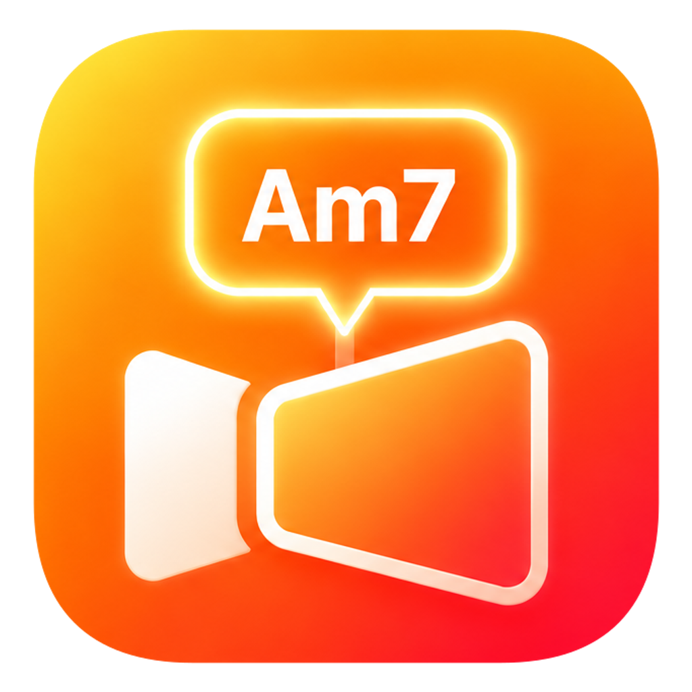
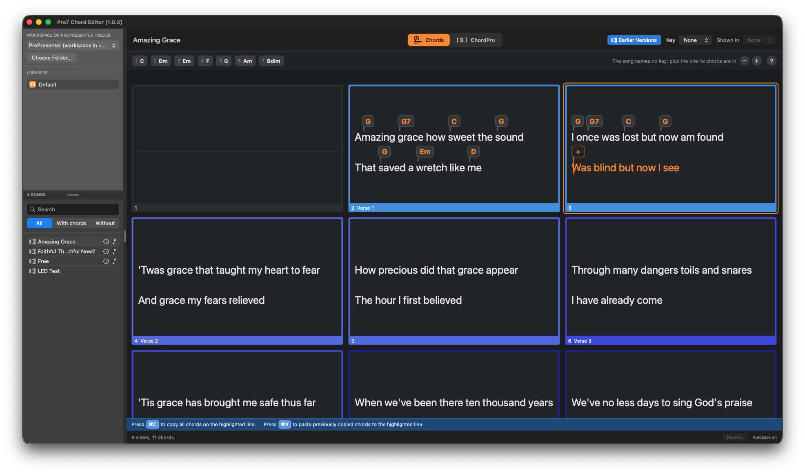
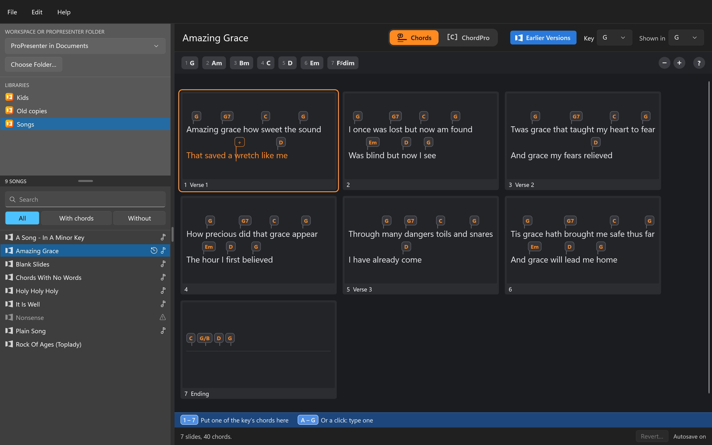

  

<h1 align="center">Pro7 Chord Editor</h1>

Puts chords on the songs of a ProPresenter 7 library, so that ProPresenter shows them
on a stage screen, as it does for songs from Multitracks.

  
  <!-- The Windows app's screenshot goes beside the Mac's. Save it as
       pictures/screenshot-windows.png, of the same kind of view (a song open on its
       chord sheet), and move the line below out of this comment.
  
  -->

ProPresenter shows the chords a song came with and has no way to put one on. This
does: it opens the library where it lies, shows a song with its chords over its
words, and lets them be put on, moved and changed.

> [!WARNING]
> **A personal hobby project, not a product.** Nobody supports it and nothing is
> promised. It changes the files of your ProPresenter library: keep a backup of the
> library, and quit ProPresenter before using it. It has nothing to do with Renewed
> Vision, the makers of ProPresenter.

## Try it

| | Download | It needs |
| --- | --- | --- |
| **Mac** | **[Pro7ChordEditor-mac-1.0.3.dmg](https://github.com/greyshirtguy/Pro7ChordEditor/releases/download/v1.0.3/Pro7ChordEditor-mac-1.0.3.dmg)** (6 MB) | macOS 15 or later, on a Mac with Apple's own chip or Intel's. [What is in it](https://github.com/greyshirtguy/Pro7ChordEditor/releases/tag/v1.0.3) |
| **Windows** | **[Pro7ChordEditor-windows-0.2.zip](https://github.com/greyshirtguy/Pro7ChordEditor/releases/download/windows-v0.2/Pro7ChordEditor-windows-0.2.zip)** (60 MB) | Windows 10 or 11, on a 64-bit PC. Nothing else has to be installed. [What is in it](https://github.com/greyshirtguy/Pro7ChordEditor/releases/tag/windows-v0.2) |

These are the new editor: 1.0.3 for the Mac, and for Windows the early build 0.2
until its own is added to the same release. Before you use one:

- **Keep a backup of your ProPresenter library, and quit ProPresenter first.**
- **Try it on a copy.** Copy one folder out of ProPresenter's `Libraries` to somewhere
  else, and open the copy with Choose Folder.
- **Neither is signed yet**, so macOS and Windows each stop it the first time it is
  opened, and have to be told to go on. The page of each download says how, and so
  does the read-me inside it.

How chords are put on with it is on one page: [the guide](spec/13-guide.md#the-words).
(The Mac app opens that page by itself the first time it is started, and has it under
Help; the Windows app is to do the same.)

**The first editor is still there.** Version 0.9.5, a Windows program of another
design, which these replace: it is
[on the Releases page](https://github.com/greyshirtguy/Pro7ChordEditor/releases/tag/v0.9.5) and works as it did, with the faults it is known to
have ([`spec/08-repair.md`](spec/08-repair.md)). The new Windows build finds what it
left in a song and mends it. (From 1.0.0 the release GitHub calls "Latest" is the new
editor's, which is to hold both downloads; so far it has the Mac's.)

## Where things stand

| | |
| --- | --- |
| **Mac** | Built as far as the two ways of putting chords on, chords where there are no words, and the guide. Not yet: mending what the first editor left in songs, and making a song from a ChordPro file. [`mac/`](mac/README.md) has the rest |
| **Windows** | Built as far as making a song from a ChordPro file, and it mends what the first editor left. [`windows/`](windows/README.md) has the rest |
| **The first editor** | Version 0.9.5, for Windows, in [`windows/old/`](windows/old/README.md). It works by typing chords in square brackets among the words |
| **What both are built to** | [`spec/`](spec/00-overview.md), page by page |

## What the new one is

The chord editor that was built for
[Simple Presenter](https://github.com/greyshirtguy/Simple-Presenter), a presenter for
Linux, lifted out and made again natively for the Mac and for Windows:

- **The whole song on one sheet**, each slide's lines in a card, with a spot that
  follows the pointer to show where the next chord will go.
- **Most chords are one key press**: the song's key is at the top with its seven
  chords numbered, and 1 to 7 put them on.
- **Typing is helped along**: a bubble that takes only what could be a chord and
  offers what it might be going to be.
- **Chords are things to pick up**: drag one to another word; copy a verse's chords
  onto the next verse in one go.
- **Or type the lot as ChordPro**, `[G]Amazing [C]grace`, as the first editor did.
- **Every change saved at once into the song's own file**, with a copy of the file
  kept first, out of sight, and a way back to any of them.
- **Songs the first editor left wrong are found and mended.** (On Windows so far.)
- **A ChordPro file, from SongSelect say, made into a song.** (On Windows so far.)

## This repository

| Folder | What it is |
| --- | --- |
| [`spec/`](spec/00-overview.md) | What the apps are to do, page by page |
| [`testdata/`](testdata/README.md) | What the rules must answer, and sample songs, for both apps' tests |
| [`reference/`](reference/README.md) | The source of the editor being copied, to read |
| [`tools/`](tools/README.md) | What made the test data, and a tool for looking inside a `.pro` file |
| `proto/` | The descriptions of ProPresenter's file formats ([ProPresenter7-Proto](https://github.com/greyshirtguy/ProPresenter7-Proto), a submodule) |
| [`windows/`](windows/README.md) | The Windows app |
| [`mac/`](mac/README.md) | The Mac app |
| `pictures/` | The pictures this page shows: the apps' icon, and a screenshot of each app (`screenshot-mac.png`; `screenshot-windows.png` is still to come) |

It is being built by describing it to an AI model. [`AGENTS.md`](AGENTS.md) is what
such a model is told before it starts, and [`spec/11-plan.md`](spec/11-plan.md) is the
plan it works to.

## Licence

MIT: see [`LICENSE`](LICENSE). The test songs are hymns long out of copyright and
made-up words. `reference/` is from Simple Presenter, under the same licence by the
same person. `proto/` has its own.

ProPresenter is a trademark of Renewed Vision. This project is not affiliated with or
endorsed by them.
