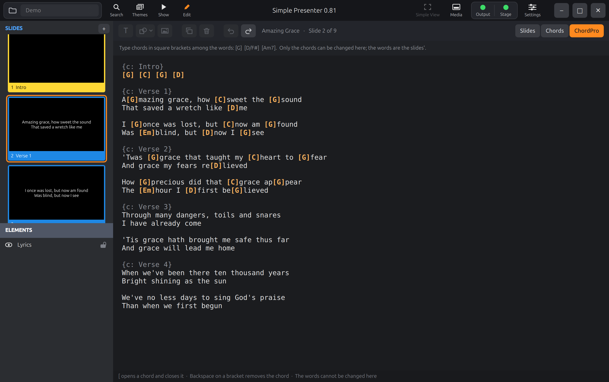

# What is being built

Pro7 Chord Editor is a small app for one job: putting chords on the songs of a
ProPresenter 7 library, so that ProPresenter shows them on a stage screen. ProPresenter
shows chords that came with a song (from Multitracks) but has no way to put one on. This
does that, on the library where it lies, and nothing else.

There are two of it, for the Mac and for Windows, and they are to work the same.

## Where it comes from

The editor exists already. It was built as part of
[Simple Presenter](https://github.com/greyshirtguy/Simple-Presenter), a presenter for
Linux, and turned out well: a whole song on one sheet, a spot that follows the pointer
to say where the next chord goes, the key's own chords on the keys 1 to 7, a bubble to
type a chord in that offers what it might be going to be. These pages describe that
editor as it is, so that it can be built again natively twice without being designed
again twice.

| | |
|:---:|:---:|
|  |  |
| The chord sheet: [03-chord-sheet.md](03-chord-sheet.md) | The ChordPro editor: [04-chordpro-editor.md](04-chordpro-editor.md) |

Simple Presenter is a presenter, with the editor inside it. This is the editor by
itself, so it needs things Simple Presenter had no call for or did another way: a way
to find and browse ProPresenter's own library, a check that ProPresenter is not
running, copies of every file before it is changed with a way back to any of them, and
a way to find and mend what an earlier chord editor did to some files.

## What it does

1. **Finds the ProPresenter library** on the computer and lists its libraries and their
   presentations, with a search, and marks on those that have chords, have copies kept,
   or need mending. ([06-library.md](06-library.md))
2. **Shows a song as one sheet** and lets chords be put on, changed, moved, copied and
   taken off with the mouse and the keys. ([03-chord-sheet.md](03-chord-sheet.md))
3. **Shows the same song as ChordPro text**, for typing chords among the words.
   ([04-chordpro-editor.md](04-chordpro-editor.md))
4. **Sets the song's key**: the key its chords are written in, and the key ProPresenter
   is to show them in. ([05-song-and-saving.md](05-song-and-saving.md))
5. **Saves every change at once**, into the song's own file, safely, and can undo it.
   ([05-song-and-saving.md](05-song-and-saving.md))
6. **Keeps a copy of every file before it is changed**, out of sight, and can put any
   of them back, and take that back too. ([07-backups.md](07-backups.md))
7. **Finds what the old Windows editor left wrong in files** and offers to put it
   right. ([08-repair.md](08-repair.md))
8. **Makes a new song from a ChordPro file**, and writes one out.
   ([09-chordpro-files.md](09-chordpro-files.md))
9. **Says how chords are put on**, on one page of its own that opens the first time
   the app is started and is under Help ever after. ([13-guide.md](13-guide.md))

## What it does not do

- Change a song's words, its slides, its looks or its arrangement. ProPresenter does.
- Show anything on a screen. It is not a presenter.
- Run while ProPresenter has the library open.
- Anything over a network.

## Decided already

By the maintainer, on 2026-10-10 ([12-origin.md](12-origin.md) has the words):

| | |
| --- | --- |
| One repository | This one, with `mac/` and `windows/` beside the shared `spec/` and `testdata/` |
| Native twice | SwiftUI on the Mac, as an ordinary Xcode project. .NET on Windows; WPF unless there is a reason found to move |
| Licence | MIT |
| Multitracks songs | Opened and changed like any other. (The old Windows editor refused them.) |
| The Mac App Store | Not used. The Mac app is given out directly, signed and notarized |
| Order | The Mac app first, then Windows |
| Words | Not changed here: only chords |

## These pages

| Page | What it has |
| --- | --- |
| [01-file-format.md](01-file-format.md) | Where a song's words, chords and key are in a `.pro` file, how places are counted, and what must never be touched |
| [02-chord-rules.md](02-chord-rules.md) | What a chord is, keys, moving to another key, the notations, what is offered as a chord is typed, ChordPro text. Each with the vectors that hold it |
| [03-chord-sheet.md](03-chord-sheet.md) | The main editor, rule by rule |
| [04-chordpro-editor.md](04-chordpro-editor.md) | The text editor, rule by rule |
| [05-song-and-saving.md](05-song-and-saving.md) | The song as the editors see it, what a change is, undo, the key, saving |
| [06-library.md](06-library.md) | Finding ProPresenter's folder, the lists, whether ProPresenter is running |
| [07-backups.md](07-backups.md) | The copies kept, and getting one back |
| [08-repair.md](08-repair.md) | What the old Windows editor did to files, how to tell, how to mend |
| [09-chordpro-files.md](09-chordpro-files.md) | A new song from a ChordPro file, and a ChordPro file from a song |
| [10-platforms.md](10-platforms.md) | What is the Mac's own way and what is Windows', how each project is laid out, how an agent sees what it has drawn, signing |
| [11-plan.md](11-plan.md) | The milestones, and what to say to start a session |
| [12-origin.md](12-origin.md) | The maintainer's own words that the editor was built from |
| [13-guide.md](13-guide.md) | The guide the app shows: when, how it is laid out, how its pictures are made. Its words are [guide.json](guide.json), which both apps carry |

## Known, guessed, and new

Every statement about ProPresenter in these pages is one of three kinds, and where it
matters the page says which:

- **Known**: seen in files ProPresenter wrote, or tried against ProPresenter.
- **A guess**: believed of ProPresenter and not yet checked. Simple Presenter's source
  says the same of each, in a comment where it happens. Keep the comment when you
  build the same thing.
- **New**: not in Simple Presenter at all, designed in these pages for this app (the
  library, the backups, the repairs, the second key). Nothing has tried these yet, so
  expect to find them wanting in places, and say where.

## Words used

| Word | Meaning |
| --- | --- |
| Library | A folder of presentations under ProPresenter's `Libraries` folder. ProPresenter shows each as a library by the folder's name |
| Presentation, song | One `.pro` file. Here nearly always a song |
| Slide | One screenful of a song's words. In the file, a cue with a slide in it |
| Group | A named run of slides: Verse 1, Chorus. In the file, a cue group |
| Text box | A box of words on a slide. In the file, an element with text. Most song slides have one |
| Words | A text box's text as plain characters, lines parted by line breaks |
| Place | A position in a text box's words: a number, counted in UTF-16 units from 0, a line break being one |
| Chord | A name ("G", "F#m7", "D/F#") standing at a place: before the character there |
| Range | How the file writes a chord: from its place to some later place |
| A line of chords alone | A line that has chords and no words: an intro, a turnaround |
| Stand-in | An invisible character such a line's chord hangs on, there being no words to hang it on |
| Original key | The key the chords in the file are written in |
| User key | The key ProPresenter is to show them in, moving each chord as it draws it |
| Sheet | The main editor's view of a song: every slide as a card of its lines, in a grid |
| Spot | The one place on the sheet the next chord will go to |
