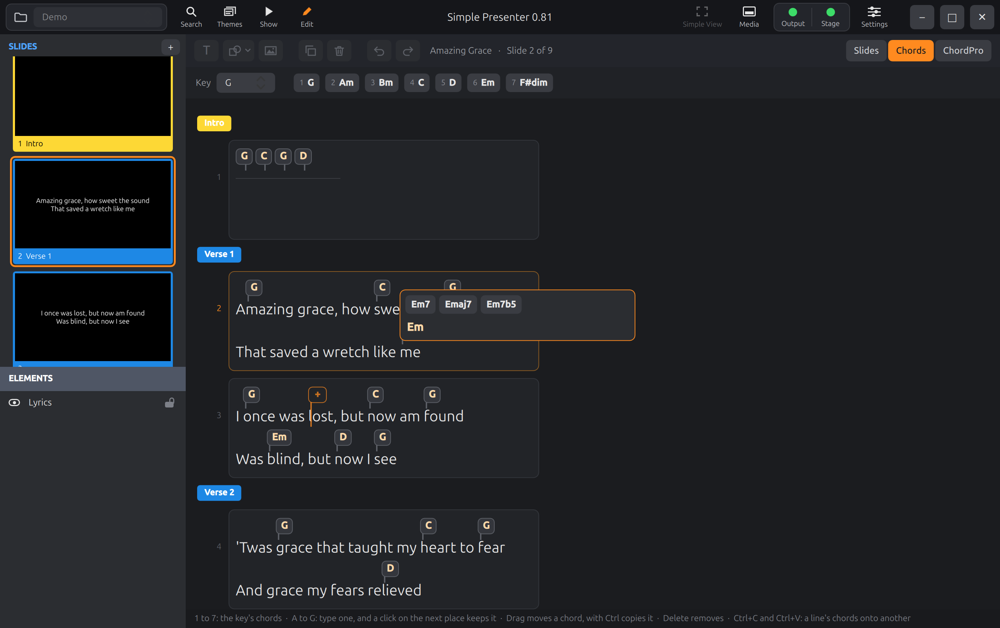
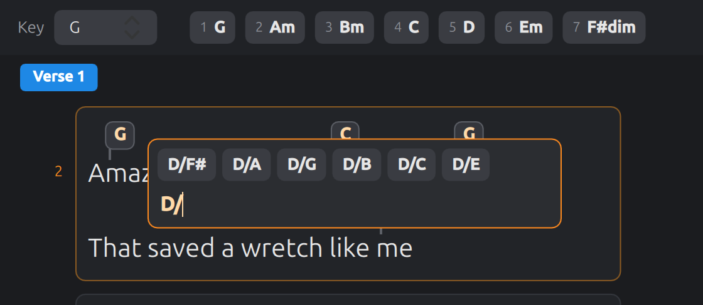
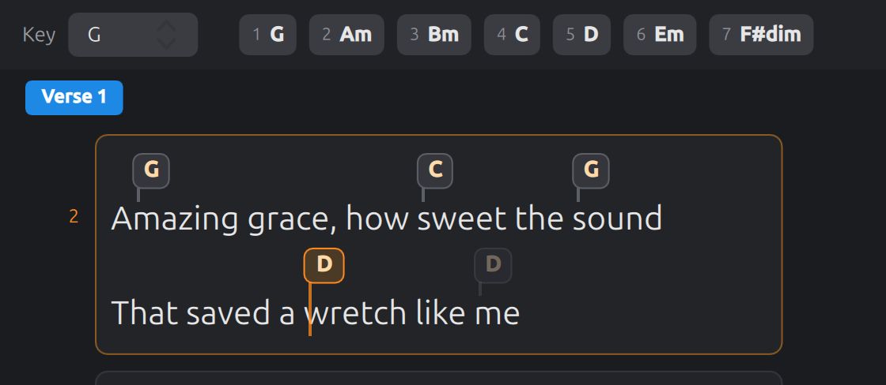

# The chord sheet

The main editor: the whole song as one sheet of words, with its chords in bubbles over
them, to be put on, changed, moved and taken off with the mouse and the keys.

**How the slides are laid out on the sheet is no longer Simple Presenter's** (the
maintainer, 2026-10-11, on trying its layout with real songs). There each slide's
lines are a card and the cards are one column, as the picture below shows. Here they
are a grid, like the slides of a presentation in ProPresenter's own window, and the
sheet zooms: "How it looks" and "Zooming" say how. Everything else on this page (a
line and its bubbles, the spot, typing, dragging, copying) is as it was, and the
maintainer means Simple Presenter to follow.

This page is the working editor of Simple Presenter written down:
`reference/simple-presenter/qml/ChordSheet.qml` (1,200 lines, a sixth of them comments
that say why) and `chordlayout.js`. Read that file before building this; where this
page and that file differ, this page says so and says why.
`reference/simple-presenter/tests/chords-scripted-test.qml` is that app's own test of
it, eighty checks that read as a list of what it must do.

Keys are named here as Windows names them. On the Mac, Ctrl is Command and Delete is
either delete key: [10-platforms.md](10-platforms.md).

## Why it is the way it is

- **One sheet, where the file has slides.** In the file each slide has its own text
  box, and a chord belongs to one box. Working a slide at a time would mean paging
  through thirty of them to chord one song. So every slide of the song is on the one
  sheet, each with all its lines. Nothing is joined underneath: a chord put on a word
  is written to that word's own text box on its own slide.
- **As much of the song in sight as the window has room for.** A song's lines are
  short and its slides many, so one column of slides leaves most of a window empty
  and shows a verse at a time. The slides go across as well as down, and the words
  can be made smaller.
- **The words cannot be changed here.** Only chords.
- **Point with one hand, press with the other.** There is one place the next chord
  goes to, the *spot*. It follows the pointer, and the arrow keys move it too. Most
  chords are then one key press.
- **Nothing has to be pressed to say a chord is done.** Click, type, click, type, down
  the song.

## The rows

The sheet is a list of rows made from the song's text boxes
([05-song-and-saving.md](05-song-and-saving.md) says what those are):

1. For each text box in order: if it is the first box of a new slide, and that slide
   starts a group that has a name, a **group row** with the group's name and colour.
2. Then one **line row** for each line of the box's words (split at line breaks, an
   empty line included). A line row knows its text box, which line of it this is, the
   place its line starts at in the box, its words, its chords with their places counted
   *along the line*, and whether it is a line of chords alone.
2a. **The empty lines a box's words end with get no row**: words that end with a line
   break, or several, would otherwise make their slide that many lines taller, and
   every card of the song with it (rule 8). One that a chord stands on is kept, with
   any before it; and a box always has one line. Nothing of the words is changed by
   this: it is only what is drawn. (**New**, asked for by the maintainer on
   2026-10-11 after seeing cards too tall in their own library, where 40 text boxes
   of 6,091 end so, in 19 songs of 422. Simple Presenter gives each such line a row.
   `sheet-model.json` has no such box.)
3. A chord belongs to the line its place is in: from the line's start up to but not
   including its line break. An empty line is taken as one place wide, so that a chord
   standing on it is not lost.
4. A line row can take the spot (is *usable*) if its words are not empty. A group row
   and an empty line cannot. The one exception is the row of a **blank slide**
   ([01-file-format.md](01-file-format.md)): its box has no words, so it is one empty
   line, and it is usable. It is a line of chords alone with none yet: rule 13 draws
   it, rule 22 gives it its one stop, and a chord put there asks the song for "this
   line of chords alone now has these". (**New**, and in Simple Presenter
   since 2026-10-10: `sheet-model.json` has it in the song `blank`. Its song `bare` is
   a slide with no text box, whose row is the same and names no box:
   [01-file-format.md](01-file-format.md), "A slide with no text box".)
5. Each slide's line rows know how many they are, which is the first and which the
   last: that is what its card is sized by (rule 8). The sheet also knows the greatest
   number any slide has, which Simple Presenter sized every card by and `sheet-model.json`
   records (`mostLines`); these apps draw nothing by it. Nor is a group row drawn as
   a row of its own: the group's name is on its first slide's frame (rule 7).

Vectors: `sheet-model.json`, `rows`.

## How it looks

6. Dark: the sheet `#1b1c1f`, the strip across its top `#202226`, a card `#222428`,
   words `#e6e6e6`. The accent is orange, `#ff8a1f`.
7. **A card for each slide, in a frame of its group's colour.** The card is a plain
   rectangle that holds the slide's lines (rule 10), with 10 clear inside it all round
   them. The frame is drawn behind it: 4 thick at the card's sides and top, with a
   **foot** 22 tall under the card, its corners rounded (radius 4). Its colour is the
   group's (ProPresenter's colour for a group of that name, as the file gives it), or
   `#2b2d31` for a slide whose group has none or that is in no group. On the foot,
   at 12, are the slide's number and, on the first slide of each group that has a
   name, two spaces and the group's name ("3", "4  Verse 2"); in white, or in black
   on a light colour (one whose 0.299 red + 0.587 green + 0.114 blue is over 0.6),
   and cut short with "…" where the frame is too narrow. This is how Simple
   Presenter's main window frames a slide's thumbnail, and ProPresenter's.
7a. **The slide that is picked has an orange ring**: 2 wide, outside its frame and set
   off from it by a little of the sheet, so that it reads against a frame of any
   colour.
8. **The slides are a grid.** They go across the sheet in the order of the song, as
   many to a row as fit, and then the next row under it. Each frame keeps 6 clear all
   round it; the sheet has a margin of 6 at its sides and its foot, and 30 at its top
   (rule 29 says why).
   - **Every card of a song is one size.** It is as wide as the widest slide of the
     song needs, and no wider. A slide needs the widest of its lines with its chords
     (rule 11; a line of chords alone, 44 more, so that the place past its last chord
     has room to be pointed at; and never less than 40), the 10 inside its card at
     each side and the frame's 4 at each side; or what the words on its foot need
     with 8 either side of them, if that is more. **No room is kept for what might be
     put on a line later**: when the widest line comes to need more, for a chord at
     its end, every card is that much wider then.
   - **A card is the shape of a screen**: as tall for its width as 9 is to 16. But it
     is never made taller for that than four lines need (four times a line's height,
     and the 10 inside it over and under), or a song of long lines would have cards
     mostly empty. So in most songs every card is 16 by 9, and in a song of long
     lines every card is wide and four lines tall.
   - **A row with a slide of more lines than that holds is as tall as that slide
     needs**: every card of that row, and of no other.
   - **A slide's lines stand in the middle of its card, up and down**, with as much
     room over the first as under the last; along, they start at its left.
   - **As many to a row as fit** across the sheet at that width, with the 6 clear
     round each frame. What is left of the sheet's width is bare, at its right.
   - Where even one card is wider than the sheet, there is one to a row, and the sheet
     scrolls sideways.
   - When the sheet is made wider or narrower the slides are laid out again, fewer or
     more to a row, with the slide that was at the top of what is seen still there.

   (In Simple Presenter all cards were one column, and one size: as wide as the
   widest line and as tall as the slide with the most lines, which the maintainer had
   asked for after trying cards of differing sizes. Tried on the maintainer's own
   library of 422 songs, a window showed some three lines of words of a song. Each
   card was then made as tall as its own slide; and then, the same day, the column
   became this grid. In the grid's first hour every card was as wide as the song's
   widest line, and a row's width was shared out among its cards; the maintainer, on
   seeing the room that left beside the words: "let's drop that pre-emptive free
   space and keep the dynamically growing only when needed". For the next hour each
   column was as wide as its own widest slide, and each row as tall as its own
   lines, which fitted the most words and made no two rows or columns alike; the
   maintainer again: "I am tempted to sacrifice some space efficiency to get the
   slides more uniform and more closer to 16:9". Hence one size, and a screen's
   shape. Of the maintainer's 422 songs, at the usual zoom, 325 have cards of 16 by
   9 and 97 are held to four lines; seven rows in a hundred are taller than their
   neighbours; and in the window as it opens some nine lines of a song's words are
   in sight.)
9. A group's name is nowhere but on the foot of its first slide's frame (rule 7), and
   a slide's number nowhere but on its own.
10. **A line** is its words at 21 pixels with a row above them for chords. A chord is a
    **bubble**: its name in bold 14, `#ffd9a8`, on a rounded rectangle `#34363c` edged
    `#5c5f66`, with 7 pixels either side of the name, and under it a **tail**, a line 2
    wide that comes down to the character the chord stands at. From the top of a line
    to the top of the next is the bubble's height (its name's and 6), the tail's 6,
    the words' height and 6 more.
11. **Where a bubble stands.** Its left edge is where its character starts. If that
    would run into the bubble before it on the line, it is pushed right until it clears
    that one by 4. Its tail still points at its own character. That is all of the
    layout, and it is one small function (`place`) so that everything that draws chords
    puts them in the same spot. Vectors: `layout.json`.
12. A line never wraps. The sheet scrolls down, and sideways only where a card is
    wider than it (rule 8).
13. A line of chords alone has no words to show: a thin rule stands where they would
    be, and its bubbles sit side by side.
14. The strip across the top has, at its left, the key's seven chords as small buttons,
    each with its number 1 to 7 in grey before its name; and at its right two round
    buttons, − and +, that zoom (rule 14b). If the song states no key, the chords are
    C's, and before the two buttons the strip says "The song names no key: pick the
    one its chords are in", where there is room for it. **The key is not picked
    here**: it is picked in the song's header over the sheet
    ([06-library.md](06-library.md), rule 12), which is there for both editors. (In
    Simple Presenter the strip begins with the word "Key" and the key's picker, and
    these pages asked for one in both places, so that the sheet showed the key twice.
    The maintainer, 2026-10-11: "we only need one".)

The sizes of a line and its bubbles are Simple Presenter's and need not be matched to
the pixel; the proportions and the look should be. The pictures in `spec/pictures`
are of Simple Presenter's sheet as it was, in one column: hold the lines, the bubbles,
the spot and the typing bubble of your own pictures up against them, and the layout
of the slides against this page.

## Zooming

14a. **The sheet zooms**: every size of rules 10 and 11, and the 10, the 44 and the 40
    of rule 8, and so the cards and how many go to a row, are so many times what
    those rules say. The steps are 50, 60, 70, 80, 90, 100,
    110, 125 and 150 in the hundred; **the usual one is 80**. What does not zoom: a
    frame's 4 and its foot, the words on the foot, the gaps between frames and the
    margins, the ring, and the bubble a chord is typed in.
14b. − and + in the strip go a step down and up, and are greyed at the ends. So do
    **Ctrl+minus** and **Ctrl+plus** (or Ctrl with the equals key, which is plus
    without Shift), and **Ctrl+0** goes back to the usual size. On a trackpad, two
    fingers spread or closed go a step for each fair stretch.
14c. The slides are laid out again at the new size, with the slide that was at the
    top of what is seen still there. The size is remembered from one start of the
    app to the next. It is the app's, not the song's: nothing in any file says it.

## The spot

15. There is one spot: a row and a place on its line. Where there is no chord at it, it
    shows as a bubble **in outline**, orange, with a "+" in it and a long tail down
    through the words. Where there is a chord, that chord's bubble is lit instead
    (`#4a3a26`, orange edge and tail).
16. **It follows the pointer.** Over a line it goes to the character under the pointer:
    the one whose left edge is nearest on the left. Over the space between two words it
    goes to the word after. With **Shift** held it goes to the start of the word
    instead. Over a chord's bubble it goes to that chord.
17. It follows the pointer only when the pointer itself has moved. A row that is laid
    out again, or scrolls, under a pointer lying still must not take the spot back from
    the keys.
18. The pointer is followed only over the cards. Between them is bare sheet, and a
    frame and its foot are bare sheet too. Every part of a card is one of its lines:
    the room over its first line (rule 8) is that line's, and the room under its
    last, the last's.
18a. **A place is never the second half of a character that takes two units** (one from
    beyond the first 65,536): the pointer goes to its first half, and the keys pass
    over the second. And a character that has no width at all (a zero-width space
    beside another, a soft hyphen) cannot be pointed at: the place is the next one
    along. The keys still reach it, with Shift. (**New**: the page was silent, and the
    reference stops on both halves.)
19. **Right and Left** move it a word at a time: to the next or the previous start of a
    word on the line, and from the end of a line to the first word of the next line
    that can take it (from the start, to the last word of the one before). With
    **Shift** they move a character at a time, spaces passed over. Note that this is
    the other way about from the pointer, on purpose: a letter at a time is a long walk
    with the keys, and a word at a time is too coarse for the mouse.
20. **Down and Up** move it to the line under or over it *on the screen* that can take
    it, to the stop of that line nearest under or over where it was. Under a slide's
    last line is the first line of the slide below it in the grid: the one in the same
    place along the next row, or that row's last slide where the row is a short one.
    Over its first line is the last line of the slide above. From the last row Down
    goes nowhere, and from the first, Up. (So with slides side by side Down does not
    go to the next slide of the song, which is beside this one: Right does, rule 19.)
21. With no spot yet, the first arrow key puts it on the first word of the song.
22. On a **line of chords alone** the stops are each chord and one more place after the
    last, for a new one. Places there are 0, 2, 4 ... (the stand-ins).
23. Moving the spot with the keys scrolls the sheet to keep it in view, and picks its
    slide (rule 7).
23a. **The keys go where the pointer is.** The sheet takes the keyboard when it is
    clicked, and also when the pointer moves over it, unless a box of text elsewhere
    in the window is being typed in. Pointing and pressing 4 then needs no click
    first. (**New**, on the Mac, where a view does not have the keyboard until it is
    given it; the maintainer agreed to it on 2026-10-11. In the reference the sheet
    has the keyboard whenever its page is open.)

Vectors: `sheet-model.json`: `wordStarts`, `stops`, `stopAt`, `walks`.

## Putting a chord on

24. **1 to 7** put the key's own chord for that note of its scale on the spot, in place
    of whatever is there. The buttons in the strip do the same when clicked.
25. **A letter A to G** opens the typing bubble on the spot with that letter in it, as
    a capital.
26. **Enter, or F2**, opens it on what is at the spot: the chord there, all of it
    selected to be typed over, or empty.
27. **A click** on a place of a line does the same there (and on a chord's bubble, on
    that chord).
28. **Delete or Backspace** takes off the chord at the spot.

## The typing bubble

29. It is a small panel at the place the chord is for, growing **upwards** from where
    the chord will stand, so that the word and the rest of its line stay in sight.
    (The sheet's top margin of 30 is room for it over the first row of slides. Where
    there is still not room, at the top of what is seen, it is kept in sight and
    covers what it must.) It
    has a one-line box to type in, and above that what the chord might be going to be,
    as a row of buttons that wraps: `completions`, the first fourteen.
30. The box takes only what could be a chord (`couldBecome`). A key press that would
    make it otherwise is undone at once. What is typed is tidied as it is typed (`f`
    becomes `F`). At most sixteen characters.
31. **Down and Up** go through what is offered, round and round; the one picked is lit
    in orange. **Right**, at the end of the box with one picked, puts that one in the
    box to be gone on with (for a bass note, say).
32. **Enter** keeps the chord: the one picked, or else what is typed. **A click** on
    one that is offered keeps that one.
33. **Tab** keeps it and moves the spot on to the next word. If nothing is picked and
    what is typed is not yet a chord, Tab takes the first that is offered.
34. **Esc** throws the typing away and changes nothing. It is the only thing that does.
35. **Backspace or Delete in an empty box** takes off the chord at that place.
36. A slash on the end of what is kept, typed on the way to a bass note that never
    came, is left off: `G/` is kept as `G`.
37. What is kept must be a chord (`isChord`). If it is not, nothing is put on.
38. **While a chord is being typed, the spot goes on following the pointer**, and shows
    where a click would start the next one. The place being typed for is remembered
    apart from the spot.
39. **A click on another place keeps what was typed and opens the bubble there.** So
    does a click on another chord. A click on the bare sheet keeps it and closes the
    bubble. So does leaving the sheet for anything else. A click on the strip's 1 to 7
    puts *that* chord where the typing was, in place of what was typed.
40. A chord cannot be dragged while another is being typed: pressing and letting go on
    it is a click on it (rule 39).

Getting rules 38 to 40 right is most of what makes the sheet quick. Note what follows
from them for the code: keeping a chord lays the sheet out again, the row that was
clicked with it, so the click must be handled by row number and place and not by the
thing that was clicked.

Vectors: `sheet-model.json`, `typing`.

## Moving and copying a chord

41. A chord's bubble can be **dragged** to any place of any line, on any slide. The
    drag starts once the pointer has moved 6 pixels with the button down. While it
    lasts the bubble left behind is faint, and the spot follows the pointer as in rule
    16, showing the chord's name in a lit bubble where it would land.
42. Let go, and the chord moves there. With **Ctrl** held as it is let go, it is copied
    and the first stays.
43. Whatever chord was at the place it lands on gives way to it.
44. Along its own line it is one change. To another line, it is put there and then
    taken from here, as two changes that undo as one (the second is *joined* to the
    first).
45. Along a line of chords alone it changes places with the others: it is taken out and
    put in at the new position, and the rest close up.
46. Dropped where it started, nothing happens.

Vectors: `sheet-model.json`, `edits`.

## A line's chords onto another line

47. **Ctrl+C** copies the chords of the spot's line. **Ctrl+Shift+C** copies those of
    its whole group: every line from the group's name down to the next group's.
48. What is copied is each chord by **which word** of its line it is on, how far into
    that word, and its name. A chord standing on the space before a word counts as on
    the word before. A line of chords alone is copied as its chords' names.
49. A line at the bottom of the window says what was copied, for a few seconds: "4
    chords copied from the line: Ctrl+V puts them on the lines from the spot's on, word
    for word". The key is named as the platform names it: on the Mac, "Command+V".
    What was copied is the sheet's own, and is not put where the system keeps what
    was copied for other apps.
50. **Ctrl+V** puts them on the lines from the spot's line on, one copied line to each
    line that can take the spot. For a line of words: each chord goes on the same
    numbered word, as far into it as it was but not past the word's last letter; a
    chord for a word the line has not got is left out. The line's own chords are
    replaced by these, all of them.
51. A copied line of chords alone goes only onto a line of chords alone, and replaces
    its chords; a copied line of words goes only onto a line of words. Where the kinds
    differ, that line is passed over, and the next copied line goes to the next line.
52. However many lines it changes, a paste undoes as one: each change after the first
    that is *made* is joined to the one before. (**Unlike the reference**, which joins
    every copied line but the first, whether or not the first changed anything. Where
    the first copied line is passed over by rule 51, its paste is joined to whatever
    was done before it, and one undo takes that back too. `sheet-model.json` has no
    such case.)

52a. **A paste says what came of it**, on the line at the bottom of the window, for a
    few seconds, as a copy does. A paste that changes nothing would otherwise look
    like a key that did not work, and by rules 50 and 51 it may rightly change
    nothing. What it says:
    - "4 chords put on the line." ("9 chords put on 3 lines.");
    - and after that, where some had no word to go on: " 1 had no word to go on, and
      was left out." (" 3 had no word to go on, and were left out.");
    - and after that, where a line was passed over for being of the other kind: " 1
      line was passed over: chords copied from a line of words go only onto a line of
      words, and chords with no words only onto a line with none.";
    - where no chord found a word in the one line: "None of the copied chords had a
      word to go on here.";
    - where every line was passed over: "Nothing was put here: chords copied from a
      line of words go only onto a line of words, and chords with no words only onto
      a line with none.";
    - with nothing copied yet: "Nothing has been copied yet. Ctrl+C copies the chords
      of the line the spot is on." (the key named as the platform names it).

    What the song refused has its own sentence
    ([05-song-and-saving.md](05-song-and-saving.md)) and nothing more is said.
    (**New**, 2026-10-11: the maintainer found that "some slides seem to not accept
    the paste". Tried on copies of their songs, 216 pastes of one line's chords onto
    another all did what rules 50 and 51 say; 37 of them were onto a blank slide or
    a line of chords alone and so did nothing, and 67 left chords out for want of a
    word. None of that was said.)
52b. **A click on a line and then Ctrl+V pastes there.** The click has opened the
    typing bubble (rule 27), and Ctrl+V in a box of text is the box's own: it pastes
    text. But while NOTHING HAS BEEN TYPED in the box, and a line's chords are the
    last thing that was copied on this computer by any program, Ctrl+V closes the
    bubble, changing nothing, and pastes from the bubble's line on. Likewise Ctrl+C
    and Ctrl+Shift+C in a box that is EMPTY, which has nothing of its own to copy,
    copy the chords of the bubble's line or of its group, and the bubble stays open.
    With anything typed in the box, or anything copied elsewhere since, the keys are
    the box's. (**New**, for the same reason: to click the line one means is the
    natural thing to do before pasting onto it. In the reference the bubble has the
    keys then, and nothing is pasted.) The keys that zoom (rule 14b) are the sheet's
    whether or not the bubble is open.

This is how a second verse gets the chords of the first. Vectors: `sheet-model.json`,
`copyPaste`.

## Undo, and the key

53. **Ctrl+Z** undoes the last change and **Ctrl+Shift+Z** or **Ctrl+Y** puts it back.
    Every change is one step, or several joined as one (rules 44 and 52).
54. The key picker, in the song's header (rule 14), sets the key the chords are
    written in ([05-song-and-saving.md](05-song-and-saving.md)). 1 to 7 and what is
    offered while typing go by it. A song that states no key is taken to be in C until one is set.
    Changing the key does not change any chord.

## What each thing asks of the song

The sheet changes nothing itself. Everything above comes down to one of two requests
to the song, each of which is saved at once:

- **"This text box now has these chords"**: the slide, the box, and the whole list of
  its chords, each with its place counted along the *whole box*. Used for every change
  to a line of words: the line's chords are worked out, and the box's other lines'
  chords are handed back with them unchanged.
- **"This line of chords alone now has these"**: the slide, the box, which line, and
  the names in order. The song makes the stand-ins to match
  ([01-file-format.md](01-file-format.md)).

Each can be marked as joined to the change before it. `sheet-model.json` records, for
every action above, exactly what is asked: `edits`, `typing` and `copyPaste`. Build
the part of the app that turns "this was done at this spot" into those requests as
plain code with no window in it, and hold it to that file.

## Chords that are not chords

Some files have chord names that are not chords: `C /// | Am ///`, `N.C.`. They are
shown as they are and kept as they are. **Unlike Simple Presenter's sheet**, which
refuses to put on anything that is not a chord and so cannot move or copy one of
these, this app holds only *newly typed* names to `isChord` (rule 37). A name the song
already has may be dragged, copied and pasted like any other, and is put as it is: a
slash on its end is not left off either (rule 36 is for what is typed). To change
one, it is typed over.

## Chords with no words

The sheet asks the song as rules 4, 22, 45 and 51 say, and the song does the rest
([01-file-format.md](01-file-format.md), "Chords with no words" and after): it writes
the stand-ins a line of chords alone needs for a chord more or a chord fewer, gives a
blank slide's box its words at its first chord, and gives a slide with no text box
one. Nothing in the sheet is different for any of it. What is seen:

- A blank slide's row, once it has a chord, is a line of chords alone like any other.
  With its last chord taken off again it is a blank slide's row again, and the file
  is what it was ([01-file-format.md](01-file-format.md), "A change of mind").
- **A line of chords alone with its last chord taken off is a line of chords alone
  still**: its row stays, the spot stays on it, it has its one stop (rule 22) and its
  thin rule (rule 13), and a chord is put on it again like its first. The song makes
  it one zero-width space ([01-file-format.md](01-file-format.md)). `sheet-model.json`
  has it in the song `under`, whose line of chords is under a line of words, and in
  `intro`. (**Decided by the maintainer on 2026-10-12.** Until then such a line,
  in a box with other lines, became an empty one that took nothing, and undo was the
  only way back.)
- What the song refuses is said on the quiet line under the sheet, in the song's own
  sentence ([05-song-and-saving.md](05-song-and-saving.md)). The one that will be
  met: a presentation with not one text box that has words (a run of pictures, a
  countdown) shows its blank slides, and a chord put on one is refused.

(The sheet was built a milestone before the song could do these, and until then the
song refused them in a sentence of its own.)

## What to hold your build to

- The model: `sheet-model.json` and `layout.json`, every case.
- The look: draw the sheet for `testdata/files/made-by-simple-presenter/Amazing
  Grace.pro` into a picture and set its lines beside those of
  `pictures/chord-editor.png` ([10-platforms.md](10-platforms.md)); and draw it
  wide, and zoomed down, to see the grid lay itself out.
- The feel, which only a person can tell: chord a verse of that song by pointing and
  pressing 1 to 7; type a run of chords click, type, click, type; drag one; copy a
  verse onto the next. Ask the maintainer to, and to say what is slower or odder than
  it was in Simple Presenter.
