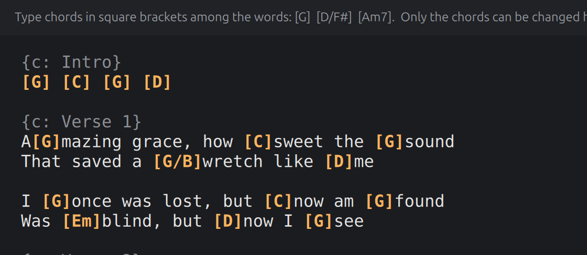

# The ChordPro editor

The same song as text: its words in one piece, with each chord in square brackets
where it is played, to be typed among. The chord sheet is for the mouse; this is for
someone who thinks in ChordPro, or has a chart to copy from. It is also what the old
Windows editor was, done properly, so people who used that will know it at once.

The working code is `reference/simple-presenter/qml/ChordProEditor.qml`, 365 lines.
Build this before the chord sheet ([11-plan.md](11-plan.md), M5): it is far less work,
and with it the app is already of use.

## The text

1. The whole song is one piece of plain text, in a fixed-width font, that never wraps.
   Line by line it is:

   | A line of the text | What it is | Can it be changed |
   | --- | --- | --- |
   | `{c: Verse 1}` | The name of a group, before its first slide | No |
   | (an empty line) | The gap between one slide and the next | No |
   | `[G]Words and [D]more words` | A line of a slide's words, with its chords | Only its chords |
   | `[C] [G] [Am]` | A line of chords alone | Its chords, freely |
   | (an empty line, where a blank slide is) | A blank slide: a line of chords alone with none yet | Chords may be typed on it |

2. It is made from the song's text boxes in order
   ([05-song-and-saving.md](05-song-and-saving.md)): an empty line before each new
   slide but the first; then, if that slide starts a group that has a name, the group's
   line; then each line of each box as `toChordPro` writes it
   ([02-chord-rules.md](02-chord-rules.md)).
3. Beside the text the editor keeps, for every line of it, what that line is: which
   text box and which line of it, where that line starts in the box, its words without
   chords, and whether it is a line of chords alone. Every rule below goes by that.

   A **blank slide** ([01-file-format.md](01-file-format.md)) is one line of the text,
   and that line is empty, whether the slide has an empty text box or none at all.
   With the empty line that parts it from the slide before,
   the text has two empty lines running there, and only by what is kept beside the
   text does the editor know which is the slide. Chords typed on it are saved as a
   line of chords alone. (**New**, and the part of blank slides least sure to be
   right: two empty lines look alike. It is built, and saves as it should; whether
   it can be lived with is for a hand at the keys to say, and **the maintainer has
   not yet tried it**. The sheet is the better place to put chords on a blank slide.)
4. Chords are coloured orange, brackets and all. The lines in curly brackets are
   greyed. The colouring never changes the text.
5. Over the text is one line of help: "Type chords in square brackets among the words:
   [G]  [D/F#]  [Am7].  Only the chords can be changed here; the words are the
   slides'."

## What may be typed

6. **The one rule.** A change to the text is let through only if, with the chords taken
   out, the text is still the words it started as. That is: it has the same number of
   lines, and for each line
   - a group's line or a gap is exactly what it was;
   - a line of words, with every `[...]` taken out (`withoutChords`), is exactly its
     words, and has no stray `[` or `]` left in it;
   - a line of chords alone, with every `[...]` taken out, is nothing but spaces;
   - whatever is in any pair of brackets could become a chord (`couldBecome`, after
     trimming).

   "Exactly" is unit for unit ([10-platforms.md](10-platforms.md), Counting
   characters): an accented letter written as one character is not the same words as
   that letter written as two, though the two look alike and many a string comparison
   calls them equal. A pair of brackets is a `[`, then anything but a bracket or a
   line break, then a `]`.
7. A change that fails the rule is put back as it was, at once, with the caret left
   where the eye expects it: where it was for a deletion, one back for a character
   typed. (Where the platform's text box asks before it changes, as the Mac's does,
   the change is simply never made, which is the same to look at; and the system's
   sound for "no" is made, as it is wherever the Mac will not take a key.)
8. That single rule covers typing in the wrong place, pasting, cutting, dropping and
   undoing alike. Do not write a rule for each.

## Help with the brackets

Since brackets are all there is to type:

9. `[` typed with nothing selected puts `[]` and leaves the caret between them.
10. `]` typed where the next character is already `]` steps over it.
11. **Backspace** just after a `[` or a `]`, or **Delete** just before one, takes the
    whole chord, brackets and all. (Only when the caret is in or beside a chord on its
    own line; otherwise the key does what it always does, and rule 6 decides.)
12. None of this happens while Ctrl, Alt or the Windows or Command key is down. (On
    the Mac the help is given to what arrives as typed text, whatever keys typed it:
    a key pressed with Command or Control never does, Option with Delete is another
    command than Delete, and several keyboards type `[` and `]` with Option held.)
    What is pasted or dropped gets none of it: a pasted `[` is a stray bracket.

## Saving

13. A change is saved **700 milliseconds after the typing stops**, and once more on the
    way out of the editor (to the sheet, to another song, on quitting), when the app
    is left for another program, and before anything else is done to the song (its
    key set, its earlier versions looked at). Nothing is
    saved while the text fails rule 6, which it cannot for long.
14. What is saved is each text box whose chords are no longer what the text says, as
    one change each ([05-song-and-saving.md](05-song-and-saving.md)). The chords of a
    line are read with `chordsOf`: each at the place it has among the line's words.
    "No longer" is held against what the text said of the box when it was made from
    the song (rule 24).
15. **Empty brackets, and ones that hold what is not yet a chord (`isChord`), are left
    out of what is saved and left in the text.** Someone half way through typing `[F#`
    must not have it saved as a chord nor taken away from them.
16. A chord typed after the last word of a line hangs on the line's last character.
17. A line of chords alone is saved as its chords' names in order. Since that can
    change its text box's words (the stand-ins), the song is read again after it, and
    any other lines still to be saved go in the next round, which follows at once.
    A blank slide's line is saved the same way, and its slide is given its words, or
    a text box ([01-file-format.md](01-file-format.md)). By rule 15 a bracket still
    empty is no chord yet: a line of three chords with the middle one's name being
    typed over has two for as long as that takes, and two stand-ins.
17a. A line of chords alone with every chord taken off it has no stand-ins and is,
    from then on, an empty line of its box like any other: a line of the text still,
    with no character of its own for a chord to hang on, so that one typed there
    goes where `tidy` puts it ([02-chord-rules.md](02-chord-rules.md)), which is the
    end of the line before. A blank slide's line is a blank slide's again, and takes
    chords as before. (As in Simple Presenter. Undo, on the sheet, brings such a
    line back.)
18. All the changes of one saving, however many rounds it took, undo as one step.
    (In the reference the next round waits for the next pause, and is a step of its
    own.)
19. When the song changes from elsewhere (an undo, the other editor, an earlier
    version put back), the text is made again from the song. When it changes because
    of what was just typed here, the text is left exactly as typed.
19a. **A save that is refused** ([05-song-and-saving.md](05-song-and-saving.md), What
    a refusal says) shows its sentence on the line under the song, and the text is
    made again from the song: the sentence says nothing was changed, and that is then
    what is seen. What was typed and not saved is gone. If the save was the one made
    on the way to something else (another song clicked, another library, a key set,
    the earlier versions), that something is not done: the song stays open with its
    sentence, and is left at the next asking. If the refusal is that the
    file was changed by something else, a button beside the sentence, **Open Again**,
    reads the song afresh from its file. (**New**: the reference leaves the text as
    typed, saying one thing while the song says another.) While ProPresenter is
    known to be running the text cannot be typed in at all
    ([06-library.md](06-library.md), rule 19).

## Words that have brackets of their own

20. If any text box's words have a `[` or a `]` in them, ChordPro text cannot tell them
    from chords. The song is then shown here but cannot be changed here, and the line
    of help says so, in a warmer colour: "This song's words have square brackets of
    their own in them, so it cannot be changed as ChordPro text. The chord sheet can
    still be used." (The last sentence only once there is a chord sheet, M6.)
20a. The same if the text as it is made from the song does not itself pass rule 6,
    since then nothing typed in it ever could: a chord in the file has a bracket or a
    line break in its name, or the words have half a character in them that text
    cannot hold. The line of help then says: "This song cannot be changed as ChordPro
    text: one of its chords has a square bracket or a line break in its name, or its
    words have a broken character in them." (**New**: in the reference such a song
    takes no change and says nothing.)

## Which slide is picked

21. The caret's line says which slide is picked: the same notion as on the sheet. When
    a slide is picked from elsewhere, the caret goes to the start of its first line and
    the text scrolls to it. (Until there is an elsewhere, M6, nothing shows it.)

## The size of the text

25. **The text can be made larger and smaller**, in the steps the sheet zooms by
    ([03-chord-sheet.md](03-chord-sheet.md), rule 14a: 50 to 150 in the hundred), the
    usual one here being 100. Two small buttons at the right of the line of help, a
    small letter A and a large one, go a step down and up, and are greyed at the
    ends; so do **Ctrl+minus** and **Ctrl+plus** (or Ctrl with the equals key), and
    **Ctrl+0** goes back to the usual size. Only the size changes: not a character
    of the text, nor where the caret is, nor what can be undone. The size is
    remembered from one start of the app to the next, apart from the sheet's: a size
    that suits a grid of slides is not the one that suits a page of text. (**New**,
    asked for by the maintainer on 2026-10-11, the sheet having a zoom and the text
    none.)

(The ChordPro editor was built two milestones before the app could add a stand-in to
a line of chords alone or take one away. Until it could, such a line kept as many
chords as it had, and a blank slide's took none. Both limits went with M7, and rules
6 and 17 stand as they are written.)

## Different from the reference, on purpose

22. **A chord the song already has that is not a chord.** Rule 6 asks that every
    bracket could become a chord. In Simple Presenter a song that already has
    `[C /// | Am ///]` in it therefore fails the rule from the start, and nothing in it
    can be changed as ChordPro. Here, the names the song has when it is opened are let
    through as they are: rule 6 holds a bracket to `couldBecome` only if what is in it
    is not, exactly, one of those names. They are saved back as they were (rule 15
    likewise lets them through).
23. **Undo** here is the text box's own, as in any box of text: Ctrl+Z takes back what
    was typed, a keystroke or a word at a time as the platform has it. Whatever it
    leaves is held to rule 6 and saved by rule 13 like anything typed, so the text and
    the song cannot come to say different things. That is how the reference does it.
    The song's own history ([05-song-and-saving.md](05-song-and-saving.md)) still gets
    a step for each saving, which the sheet's Ctrl+Z will walk back through
    later. The text box's undo is forgotten whenever the text is made again from the
    song (rules 19 and 19a).
24. **Only the boxes that were typed in are saved.** The reference saves a box when
    what the text says is not what the *file* has, and the two can differ before
    anything is typed: a chord whose name is not tidy ("g"), or one past the end of
    its words, which the text cannot show as it is. Typing in one box then writes
    every such box in the song, and drops what the text could not show. Here a box is
    saved when what the text says of it is no longer what the text said when it was
    made from the song. A song with such chords is the old editor's damage as often as
    not, and is for mending on purpose ([08-repair.md](08-repair.md)), not by the
    way.

## What to hold your build to

- Rule 6 as a plain function of (the lines as they were, the text as it is now), with
  tests of your own: there are no vectors for it, since it lives in the QML. Take the
  cases from `reference/simple-presenter/tests/chords-scripted-test.qml` (search for
  "ChordPro"), which tries typing over a word, into a group's name, a chord in each
  kind of line, and a paste.
- What is saved (rules 14 to 17) against the same song changed on the sheet: the same
  chords put on both ways must give the same file.
- Rule 24: a song with an untidy name and a chord past its words in one box, typed in
  in another, has the first box's entries as they were, to the last field.
- The text box itself, typed into a key at a time by a test: a character over a word
  (nothing happens), `[` (its other comes), a name, `]` (stepped over), Backspace on
  a bracket, a paste, the box's own undo; and after each, what the file has.
