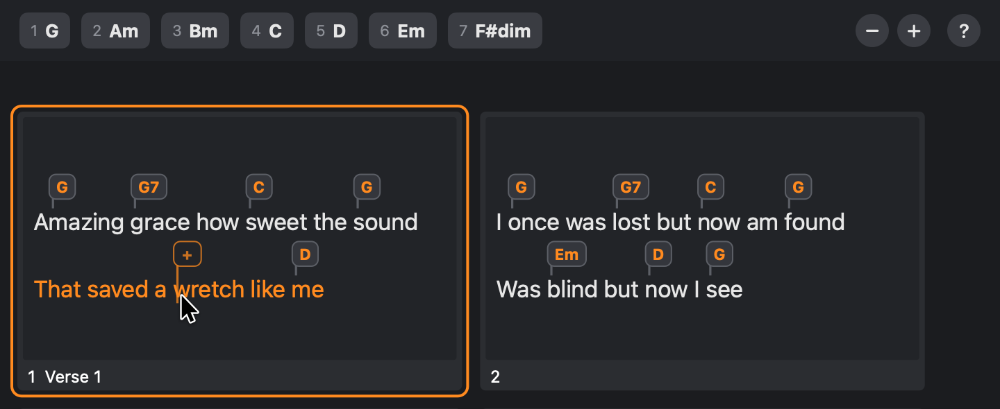
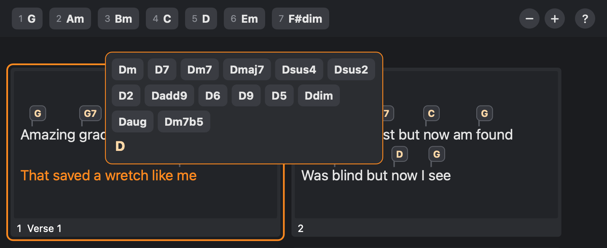
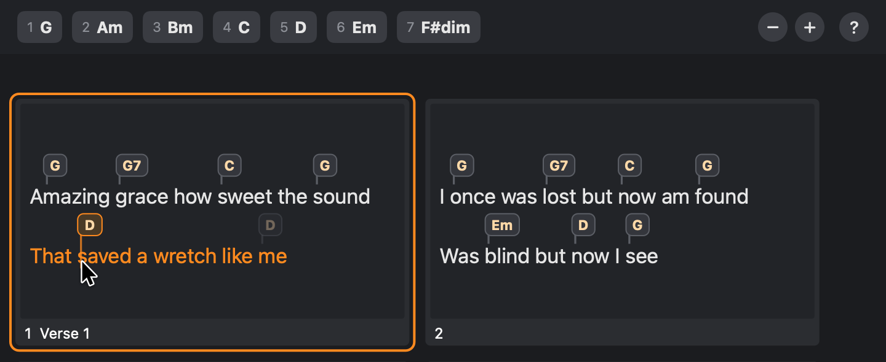

# The guide

One page, inside the app, that says how chords are put on a song: the one quick way
first, and under it every other way, as a list to come back to. It opens by itself
once, the first time the app is started, and is under Help ever after.

**New**, and the maintainer's, on 2026-10-12: "let's explore options to a nice
onboarding experience to reveal all the cool editing options", then "lets build the
guide - open it once at first start", and "the guide will have mac screenshots - for
mac - but win screenshots for win". Simple Presenter has no guide; whether it is to
have this one is the maintainer's to say.

**The guide's words are in [`guide.json`](guide.json), beside this page.** This page
says when the guide is shown, how it is laid out and how its pictures are made, and at
its foot it repeats the words, so that they can be read here.

## Why it is the way it is

- **One thing is kept from a first look, so one thing is said large**: point at a word
  and press 1 to 7. It is what makes the sheet quick, and nobody finds it by looking
  at a window. Everything else is a list under it, which is read on the second visit,
  by someone who wants to know how a chord is moved.
- **What matters more than any way of putting a chord on is said before all of them**:
  that a backup is to be kept, that ProPresenter is to be quit, that there is no Save
  because every change is saved as it is made, and that a copy is kept first.
- **It is a page and not a video.** Nobody opens a video to look one key up; a video
  is wrong the day the window changes; and one carried in the app would more than
  double what is downloaded. (A short one may be linked from the page once the app's
  looks have settled. It is the maintainer's to make.)
- **Its pictures are drawn by the tests** from the app's own sheet, so that they
  change when the sheet does.
- **It is a window that need not be put away.** What it says is to be tried as it is
  read, on the song beside it.

## When it is shown

1. **The guide is a window of its own**, beside the app's main window, and the app is
   used as ever while it is open. It is not a question to be answered: it has nothing
   to press but what closes a window. There is one of it: asked for while it is open,
   it comes to the front. Its title is "Pro7 Chord Editor Guide".
2. **It opens by itself once: the first time the app is started on a computer.** That
   is, at the first start at which the app's own settings
   ([06-library.md](06-library.md), "What the app keeps of its own") do not say that it
   has been shown: `guideShown` in `settings.json`. That is written when the guide
   opens, not when it is closed, and writing it changes nothing else that is kept. So
   someone who had the app before it had a guide sees it once too, and so does someone
   whose settings were lost. It opens once the libraries have been found, in front of
   the main window and to one side of it where the screen has room, without waiting
   for the songs' marks to be worked out.
3. **It is asked for in two places.** In the menus, under Help: **Pro7 Chord Editor
   Guide**, with the platform's own key for help ([10-platforms.md](10-platforms.md)).
   And at the right of the strip over the chord sheet
   ([03-chord-sheet.md](03-chord-sheet.md), rule 14): a third round button after − and
   +, a little apart from those two, with a question mark on it. Pointed at, it says:
   "The guide: the ways to put a chord on, on one page. It is in the Help menu too."
4. A guide left open when the app is quit is not opened by the app at its next start:
   rule 2 is the only way it opens unasked. (Where the system would put an app's
   windows back as they were, as macOS may, that is switched off for this window.)
5. Nothing in the guide does anything, to a song, to what the app keeps, or to the
   app. It is read.

## What it says, and how it is laid out

6. **The words are `guide.json`'s, and each app carries a copy of that file, the same
   to the byte**, as its own, and shows what the copy says. Neither app has a sentence
   of the guide in its code. A test in each holds its copy to the one in this folder.
   So a wording is changed in one place, and until an app has taken the change its
   tests fail.
7. **Where a key is named, the file has a short name in curly brackets**, as in
   `{ctrl}+C`, and under `names` each platform's word for each short name: "Ctrl" and
   "Command". An app puts its own platform's in. No curly bracket is ever shown.
8. In order, down one page that scrolls:
   - the **title**, large;
   - **what to know first** (`first`): its heading, and its points one under another,
     in a box tinted with the sheet's orange (`#ff8a1f`), so that it is seen before
     anything else and read as apart from the ways that follow;
   - each **section**: its heading; then, if it has one, its `lead`, in the sheet's
     orange and larger than anything on the page but the title (only the first
     section has one: the quick way); its picture; its paragraphs; its `items`, each
     a few words in bold (`lead`) run on into what they mean (`text`), with a small
     orange point before it and, if it has a picture, that under it; and its
     `sample`, a line of ChordPro text shown as the ChordPro editor shows one, in
     letters of one width, its chords in the colour chords have there
     ([06-library.md](06-library.md), rule 20a);
   - the **foot**, small and grey, under a line.
9. A line of the words is at most some 720 wide, with a margin of 30 round the page.
   The window opens some 780 wide and 820 tall, which shows everything down to the end
   of the quick way, and can be made any size: narrower, the pictures are shown
   smaller; wider, they are never shown larger than they were drawn. The words can be
   selected and copied.
10. The page is light or dark as the system is. Its pictures are of the sheet, which
    is dark in both.
11. If the app cannot find its copy of the words, the window says "The guide could not
    be found in this copy of the app." and nothing else is the worse for it. (The copy
    is the app's own and is always there. But the app opens this window by itself, at
    its first start, and is not to fall over there for the want of a file.)

## The pictures

12. **Each app's pictures are of its own sheet**: the Mac's of the Mac app, Windows' of
    the Windows app, so that what is seen in the guide is what is seen in the window
    beside it. The scenes are the same in both. `guide.json` says under `pictures`
    what each one shows, in a sentence that is also what is said of the picture to
    someone who cannot see it.
13. **They are drawn by the app's own tests** ([10-platforms.md](10-platforms.md),
    "Seeing what you have drawn") from
    `testdata/files/made-by-simple-presenter/Amazing Grace.pro`, and **kept in the
    repository**, in the app's own folder, as part of the app. Each is **the strip and
    under it the first row of slides**, as the window shows them with the sheet at its
    usual size, in a pane 720 wide and as tall as that row needs; drawn at **two dots
    to the point**, so 1440 across, whatever screen the machine has; with no scroll
    bar in it.

    | Its name | The sheet | The pointer |
    | --- | --- | --- |
    | `point-and-press` | As the song opens, with the spot on the "w" of "wretch" in "That saved a wretch like me", which has no chord: so the spot is the orange outline with a plus in it | On that letter |
    | `typing` | With the bubble a chord is typed in open at that same place, and "D" typed in it: the fourteen chords it offers are over the box | None |
    | `dragging` | With that line's chord, the D over "like", picked up and carried over the "s" of "saved": the bubble it left is faint, and its name is lit where it would land | On that letter |

14. **A window that is drawn has no pointer in it, so the test draws one in** where it
    would be: the platform's own arrow, its tip at the foot of the letter. It is drawn
    by the test and not taken from the system, whose own picture of it is whatever
    size and colour the person has made theirs.
15. **A test holds the kept pictures to what the app draws now**, dot for dot, and
    when they are not the same it fails and says how they are made again: a picture
    in the guide of a sheet the app no longer draws is a comment that has become
    untrue. They are made again by running that test with a setting that says so (on
    the Mac, `PRO7_GUIDE_PICTURES=write`), **looked at**, and committed. (Dot for dot
    holds on the kind of machine the pictures were made on. On GitHub's, the Mac
    app's test sees only that each picture is there, is of the size it should be, and
    is not blank.)

## The words

As Windows says them. On the Mac Ctrl is Command, the key that copies a chord as it is
dragged is Option, Enter is Return, Ctrl+Shift+C is Shift+Command+C, and Ctrl+Y is
Shift+Command+Z: `names`, in the file. The file is what the apps show. This is the
same, set out to be read, and a test of the Mac app holds every sentence of it to the
file. The pictures here are the Mac app's.

---

#### Putting chords on a song

**Before you start**

- Keep a backup of your ProPresenter library. This app changes the files of its songs.
- Quit ProPresenter first. Nothing is saved while it is running.
- Every change is saved as it is made, into the song’s own file. There is no Save.
- A copy of a song’s file as it was is kept before the app changes it. Earlier Versions,
  over a song that has been changed, puts a copy back.

**The quick way**

**Point at a word and press 1 to 7.**

Across the top of the sheet are the seven chords of the song’s key, numbered. Move the
pointer over the words and an orange outline follows it: the spot, where the next chord
will go. Press a number and that chord is put there. Nothing has to be clicked first.

The seven go by the song’s key, which is picked over the song. A song that names no key
is taken to be in C until one is picked.

**Other ways to put a chord on**

- **Type it.** Click a place, or press a letter from A to G with the spot there, and
  type the chord: G, F#m7, D/F#. What it might be going to be is offered as you type:
  Down and Up choose one, and Enter keeps it. Then click the next place: what was typed
  is kept, and the next chord is begun. Tab keeps it too, and moves on to the next word.
  Esc throws away what was typed.

  

- **Click one of the seven** in the strip, and it goes on the spot.
- **Drag one of the seven** out of the strip, and let it go on a word.
- **On any letter.** A chord can stand on any letter of a word: the spot goes to the
  letter under the pointer. With Shift held it keeps to the starts of words.
- **With the keys alone.** The arrow keys move the spot: Left and Right a word at a
  time, or with Shift a letter at a time, and Up and Down a line. Enter begins a chord
  at the spot, or opens the one that is there to be typed over.

**Changing what is there**

- **Move a chord:** drag its bubble to another word, on any slide. With Ctrl held as it
  is let go, it is copied and the first one stays.

  

- **Change a chord:** point at it and press 1 to 7, or click it and type over it.
- **Take a chord off:** point at it and press Delete.
- **Give a line the chords of another:** with the spot on a line, Ctrl+C copies that
  line’s chords, and Ctrl+Shift+C those of its whole group (a verse, a chorus). With the
  spot on another line, Ctrl+V puts them on the lines from there on, word for word.
- **Take a change back:** Ctrl+Z undoes the last change, and Ctrl+Y puts it back.
  Revert, under the song, takes back every change made since the song was opened.

**Where there are no words**

A slide with no words on it, such as an intro, takes chords too: point at it and press a
number, or click it and type. So does a line that has chords and no words.

**The whole song as text**

ChordPro, beside Chords over the song, shows the song as text, with each chord in square
brackets where it is played. Chords are typed in among the words. Only the chords can be
changed there: the words stay as they are. Ctrl+1 shows the sheet and Ctrl+2 the text.

`[G]Amazing [G7]grace how [C]sweet the [G]sound`

**Seeing more of a song**

The − and + at the right of the strip make the words smaller and larger, so that more
slides or fewer are in view. Ctrl with the minus and plus keys does the same.

This page is in the Help menu, and behind the ? at the right of the strip.

---

## What to hold your build to

- The app's copy of `guide.json` is this folder's, to the byte.
- Every short name in curly brackets has a word on your platform, and no curly bracket
  is left in anything the guide says.
- Every picture the words name is kept, is 1440 dots across, and is not blank; none is
  kept that the words do not name; and each is what the app draws now (rule 15).
- **Shown once**: at a first start the guide is asked for and `guideShown` is written;
  at the next start it is not asked for. With settings from before there was a guide,
  it is asked for once, and everything else that was kept is afterwards as it was, to
  the last thing. With settings that cannot be read, it is asked for.
- Nothing but the guide's opening writes that it was shown: what the app remembers
  before its first start (a folder chosen, say) does not, and the guide still opens.
- Each picture is on the page where the words have it. (The Mac app first held this
  by counting the colours of the page as drawn, and a page with a picture left out
  passed. It is told now by how much of the sheet's own dark is on a light page:
  three pictures' worth, one, or none.)
- The window, drawn into pictures and looked at: as it opens, in the light and in the
  dark; made narrow; and the whole page.
- By hand, since no test has an app to open a window in: that it opens at the first
  start, over the main window; that it does not open at the second; that Help and the
  question mark in the strip each open it, and bring it to the front when it is open
  already; and that a chord can be put on in the main window while it is open.
