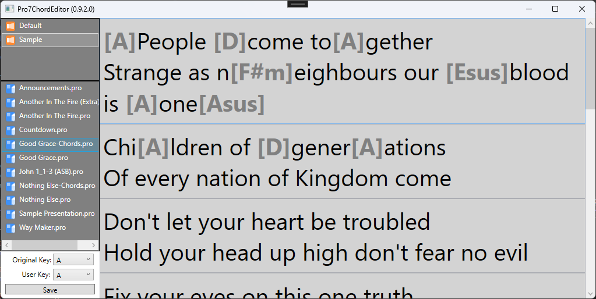
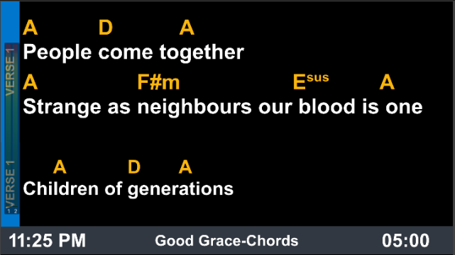

# Pro7ChordEditor for Windows

> [!NOTE]
> **This is the first Windows editor, version 0.9.5, as it has been since 2024.** It
> is to be replaced by a new one, built to the plan in [`spec/`](../spec/00-overview.md)
> alongside a Mac app. Until then this folder holds it unchanged, and its
> [latest release](https://github.com/greyshirtguy/Pro7ChordEditor/releases/latest)
> still works as it did.
>
> It has faults that are known and will not be mended in this version: a chord can be
> shown twice by ProPresenter after a save, a song's key can be changed to A flat by a
> save, and it stops on slides with no words.
> [`spec/08-repair.md`](../spec/08-repair.md) has the whole list, and the new editor is
> to find and mend what this one left in files. Keep a backup of your library.

What follows is its own README, as it was.

---

*Yep, it does what is says on the box!*  

This is a very simple/crude chord editor for Pro7 on Windows: (For now, editing MT documents is blocked until I learn is this is safe/okay.)

*Mac version is on my "TODO one-day list"*

You can add/edit chords to the lyrics of a song by typing them in [ChordPro](https://www.chordpro.org/) format. (Close Pro7 first).  
Just type them directly inline with the lyrics text [in square brackets]. You can insert a chord by typing either [, ], or any letter from A-G.
Once saved, re-open Pro7 and the inline chords can then be displayed using the `Chords` option for textboxes on your stage display (the same as Multitracks).  

  
  
NB: You cannot edit the text of the song - you can only add/edit chords.  
You can change the `User Key` to have Pro7 *automatically transpose* the chords from the `Original Key`.  
  
⚠️This is an early beta version not for production use.⚠️  

However - feel free to take the [latest release](https://github.com/greyshirtguy/Pro7ChordEditor/releases/latest) for a test-drive...   
...after making a 🦺BACKUP OF YOUR LIBRARIES🦺

**TODO:**
- Advertise for some public testers
- Test lots, gather feedback, discover and fix bugs until it's considered safe for general use.
- Currently it defaults to only looking at the *first* textbox on each slide - no support for 2nd/3rd etc textboxes...
- Probably make a new library for all presentations saved by this app (to keep them separated in a single folder)
- Perhaps add backups?

For safety it will NOT overwrite your existing files! Instead, when you save changes - it makes a copy of that file with a new name (`... (Chords)` suffix added).
*If you choose to edit the new copy with the `... (Chords)` suffix, saved changes will overwrite that file*

Usual disclaimers apply - this is an *unsupported* 3rd party app - and it's very early in development - Use at your own risk!

Contributions welcome!
